| Information | Details | Additional Information |
| :--- | :--- | :--- |
| Student Name | SHIVA SHANKAR RANGAPURAM | |
| Student Registration Number | 252U1R5126 | Class & Section: 313 AI DE 2B |
| Study Level : UG/PG/Doctorate | UG | Year & Term: 2 & 2 |
| Subject Name | Backend Development Fundamentals | |
| Teacher / Faculty Name | Mr Yugandhar Gurjalwar | |
| Name of the Assessment | LAB REPORT - 3 | |
| Date of Submission | 6/11/2026 | |

# Lab 3: REST API, query parameters, validation, debugging

## Objective

The objective of this laboratory assignment is to design and implement a clean, robust RESTful API using Node.js, Express, and SQLite for managing a collection of books. Key goals include:
1. Naming endpoints strictly as nouns (`/books/`) and leveraging standard HTTP methods (`GET`, `POST`, `PUT`, `DELETE`) to denote actions.
2. Adding comprehensive query parameters to `GET /books/` for text searching (`search_q` with SQL `LIKE`), column sorting (`order_by`), sort direction (`order`), pagination (`limit` and `offset`), and price range filtering (`min_price` and `max_price` with `BETWEEN`).
3. Enforcing rigorous request body validation for creating and updating records with clear, consistent JSON error responses (`400 Bad Request`).
4. Returning semantic HTTP status codes (`200 OK`, `201 Created`, `400 Bad Request`, `404 Not Found`, `500 Internal Server Error`).
5. Preventing SQL injection through parameterized SQL queries (`?` placeholders) and strict column name whitelisting.
6. Practicing practical debugging of common backend failure modes including port conflicts (`EADDRINUSE`), path/module import errors, database table-name typos, and unawaited asynchronous promises.

---

## How to Run

### Prerequisites
- Node.js (v18.0.0 or higher recommended)
- npm (v9.0.0 or higher)
- SQLite3 CLI (optional, for direct terminal database inspection)

### Installation
1. Clone or navigate to the repository folder:
   ```bash
   cd backend-development-fundamentals/lab-03
   ```
2. Install the necessary project dependencies:
   ```bash
   npm install
   ```

### Database Setup & Seeding
To initialize the SQLite database (`books.db`), create the `book` table, and populate it with 10 seed records, execute:
```bash
npm run setup
```
*(Or alternatively run: `node setupDb.js`)*

### Starting the Server
Start the Express server on port 3000:
```bash
npm start
```
*(Or alternatively run: `node app.js`)*

The server will initialize the SQLite database connection and listen at:
```
http://localhost:3000/
```

---

## API Endpoints

| HTTP Method | Route | Parameters / Payload | Success Status | Error Status | Description |
| :--- | :--- | :--- | :--- | :--- | :--- |
| `GET` | `/books/` | Query: `search_q`, `order_by`, `order`, `limit`, `offset`, `min_price`, `max_price` | `200 OK` | `500 Internal Server Error` | Retrieves a list of books matching the search, price range filter, sorting order, and pagination criteria. |
| `GET` | `/books/:bookId/` | Path: `bookId` (integer) | `200 OK` | `404 Not Found`, `500` | Retrieves details of a specific book by its primary key ID. |
| `POST` | `/books/` | Body: `{ "title": string, "author": string, "price": number, "pages": number }` | `201 Created` | `400 Bad Request`, `500` | Validates body and inserts a new book record into the database. Returns newly created `bookId`. |
| `PUT` | `/books/:bookId/` | Path: `bookId`<br>Body: `{ "title": string, "author": string, "price": number, "pages": number }` | `200 OK` | `400 Bad Request`, `404 Not Found`, `500` | Validates body, checks if book exists (404 if absent), and updates the record in full. |
| `DELETE` | `/books/:bookId/` | Path: `bookId` (integer) | `200 OK` | `404 Not Found`, `500` | Checks if book exists (404 if absent) and deletes the record from the database. |

---

## Source Code

### `app.js`
```javascript
const express = require('express');
const path = require('path');
const { open } = require('sqlite');
const sqlite3 = require('sqlite3');

const app = express();
app.use(express.json());

const dbPath = path.join(__dirname, 'books.db');
let db = null;

const initializeDBAndServer = async () => {
  try {
    db = await open({
      filename: dbPath,
      driver: sqlite3.Database
    });
    app.listen(3000, () => {
      console.log('Server Running on port 3000');
    });
  } catch (error) {
    console.log(`DB Error: ${error.message}`);
    process.exit(1);
  }
};

initializeDBAndServer();

app.get('/books/', async (req, res) => {
  const {
    search_q = '',
    order_by = 'id',
    order = 'ASC',
    limit = 10,
    offset = 0,
    min_price,
    max_price
  } = req.query;

  const validColumns = ['id', 'title', 'author', 'price', 'pages'];
  const sanitizedOrderBy = validColumns.includes(order_by.toLowerCase()) ? order_by.toLowerCase() : 'id';
  const sanitizedOrder = order.toUpperCase() === 'DESC' ? 'DESC' : 'ASC';

  let priceFilterQuery = '';
  const queryParams = [`%${search_q}%`];

  if (min_price !== undefined && max_price !== undefined) {
    priceFilterQuery = ' AND price BETWEEN ? AND ?';
    queryParams.push(Number(min_price), Number(max_price));
  } else if (min_price !== undefined) {
    priceFilterQuery = ' AND price >= ?';
    queryParams.push(Number(min_price));
  } else if (max_price !== undefined) {
    priceFilterQuery = ' AND price <= ?';
    queryParams.push(Number(max_price));
  }

  queryParams.push(Number(limit), Number(offset));

  const getBooksQuery = `
    SELECT *
    FROM book
    WHERE title LIKE ?${priceFilterQuery}
    ORDER BY ${sanitizedOrderBy} ${sanitizedOrder}
    LIMIT ? OFFSET ?;
  `;

  try {
    const books = await db.all(getBooksQuery, queryParams);
    res.status(200).send(books);
  } catch (error) {
    res.status(500).send({ message: error.message });
  }
});

app.get('/books/:bookId/', async (req, res) => {
  const { bookId } = req.params;
  const getBookQuery = 'SELECT * FROM book WHERE id = ?;';
  try {
    const book = await db.get(getBookQuery, [bookId]);
    if (book === undefined) {
      res.status(404).send({ message: 'Book Not Found' });
    } else {
      res.status(200).send(book);
    }
  } catch (error) {
    res.status(500).send({ message: error.message });
  }
});

app.post('/books/', async (req, res) => {
  const { title, author, price, pages } = req.body;
  if (!title || typeof title !== 'string' || title.trim() === '') {
    return res.status(400).send({ message: 'Title is required' });
  }
  if (!author || typeof author !== 'string' || author.trim() === '') {
    return res.status(400).send({ message: 'Author is required' });
  }
  if (price === undefined || price === null || typeof price !== 'number' || isNaN(price) || price < 0) {
    return res.status(400).send({ message: 'Price must be a valid non-negative number' });
  }
  if (pages === undefined || pages === null || typeof pages !== 'number' || isNaN(pages) || pages < 0) {
    return res.status(400).send({ message: 'Pages must be a valid non-negative number' });
  }

  const addBookQuery = 'INSERT INTO book (title, author, price, pages) VALUES (?, ?, ?, ?);';
  try {
    const dbResponse = await db.run(addBookQuery, [title.trim(), author.trim(), price, pages]);
    res.status(201).send({
      bookId: dbResponse.lastID,
      message: 'Book Added Successfully'
    });
  } catch (error) {
    res.status(500).send({ message: error.message });
  }
});

app.put('/books/:bookId/', async (req, res) => {
  const { bookId } = req.params;
  const { title, author, price, pages } = req.body;
  if (!title || typeof title !== 'string' || title.trim() === '') {
    return res.status(400).send({ message: 'Title is required' });
  }
  if (!author || typeof author !== 'string' || author.trim() === '') {
    return res.status(400).send({ message: 'Author is required' });
  }
  if (price === undefined || price === null || typeof price !== 'number' || isNaN(price) || price < 0) {
    return res.status(400).send({ message: 'Price must be a valid non-negative number' });
  }
  if (pages === undefined || pages === null || typeof pages !== 'number' || isNaN(pages) || pages < 0) {
    return res.status(400).send({ message: 'Pages must be a valid non-negative number' });
  }

  try {
    const checkBookQuery = 'SELECT * FROM book WHERE id = ?;';
    const book = await db.get(checkBookQuery, [bookId]);
    if (book === undefined) {
      return res.status(404).send({ message: 'Book Not Found' });
    }

    const updateBookQuery = 'UPDATE book SET title = ?, author = ?, price = ?, pages = ? WHERE id = ?;';
    await db.run(updateBookQuery, [title.trim(), author.trim(), price, pages, bookId]);
    res.status(200).send({ message: 'Book Updated Successfully' });
  } catch (error) {
    res.status(500).send({ message: error.message });
  }
});

app.delete('/books/:bookId/', async (req, res) => {
  const { bookId } = req.params;
  try {
    const checkBookQuery = 'SELECT * FROM book WHERE id = ?;';
    const book = await db.get(checkBookQuery, [bookId]);
    if (book === undefined) {
      return res.status(404).send({ message: 'Book Not Found' });
    }

    const deleteBookQuery = 'DELETE FROM book WHERE id = ?;';
    await db.run(deleteBookQuery, [bookId]);
    res.status(200).send({ message: 'Book Deleted Successfully' });
  } catch (error) {
    res.status(500).send({ message: error.message });
  }
});

module.exports = app;
```

### `setupDb.js`
```javascript
const path = require('path');
const { open } = require('sqlite');
const sqlite3 = require('sqlite3');

const dbPath = path.join(__dirname, 'books.db');

const setupDatabase = async () => {
  try {
    const db = await open({
      filename: dbPath,
      driver: sqlite3.Database
    });

    await db.exec(`
      DROP TABLE IF EXISTS book;
      CREATE TABLE book (
        id INTEGER PRIMARY KEY AUTOINCREMENT,
        title TEXT NOT NULL,
        author TEXT NOT NULL,
        price INTEGER NOT NULL,
        pages INTEGER NOT NULL
      );
    `);

    const books = [
      ['The Great Gatsby', 'F. Scott Fitzgerald', 350, 180],
      ['To Kill a Mockingbird', 'Harper Lee', 450, 281],
      ['1984', 'George Orwell', 299, 328],
      ['The Catcher in the Rye', 'J.D. Salinger', 399, 214],
      ['Pride and Prejudice', 'Jane Austen', 250, 279],
      ['The Hobbit', 'J.R.R. Tolkien', 499, 310],
      ['Harry Potter and the Sorcerer\'s Stone', 'J.K. Rowling', 599, 309],
      ['The Alchemist', 'Paulo Coelho', 320, 208],
      ['Animal Farm', 'George Orwell', 199, 112],
      ['The Lord of the Rings', 'J.R.R. Tolkien', 850, 1178]
    ];

    for (const book of books) {
      await db.run(
        'INSERT INTO book (title, author, price, pages) VALUES (?, ?, ?, ?);',
        book
      );
    }

    await db.close();
    console.log('Database initialized and 10 books seeded successfully.');
  } catch (error) {
    console.log(`Setup Error: ${error.message}`);
    process.exit(1);
  }
};

setupDatabase();
```

### `package.json`
```json
{
  "name": "lab-03",
  "version": "1.0.0",
  "description": "Backend Development Fundamentals - Lab 3: REST API, query parameters, validation, debugging",
  "main": "app.js",
  "scripts": {
    "start": "node app.js",
    "setup": "node setupDb.js"
  },
  "dependencies": {
    "express": "^4.21.2",
    "sqlite": "^5.1.1",
    "sqlite3": "^5.1.7"
  }
}
```

---

## Output & Screenshots

### 1. Default GET Books
Retrieves all seeded books with default query parameters (`limit=10`, `offset=0`, `order_by=id`, `order=ASC`).
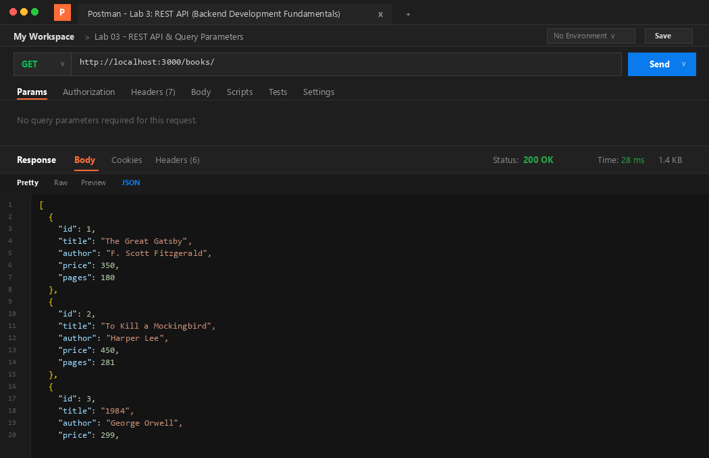

### 2. Search Query (`?search_q=the`)
Filters the collection by matching titles containing the substring `"the"` (case-insensitive partial match using SQL `LIKE`).
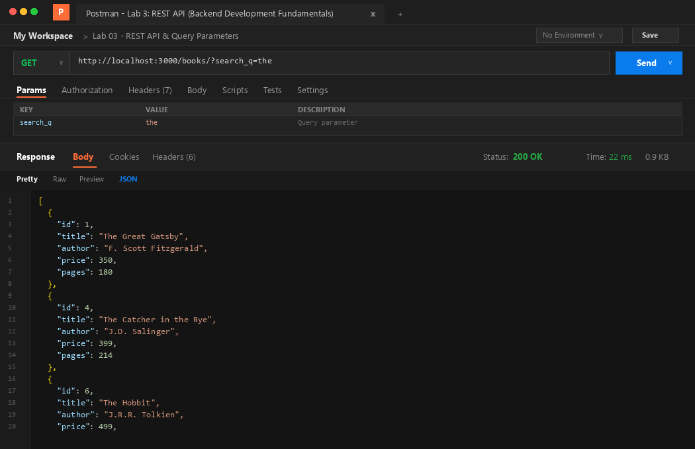

### 3. Price Range Filter (`?min_price=300&max_price=600`)
Filters books whose price falls inclusively between 300 and 600 using SQL `BETWEEN ? AND ?`.
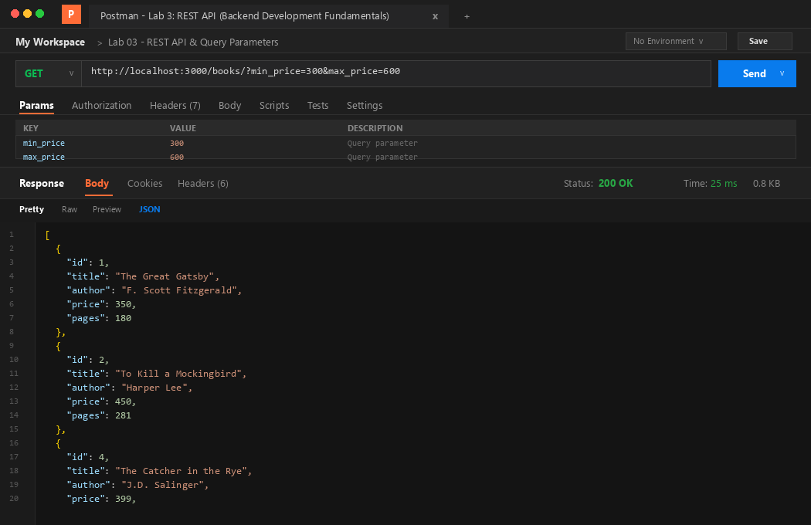

### 4. Sorting & Pagination (`?order_by=price&order=DESC&limit=4`)
Sorts the books in descending order by price and returns the top 4 most expensive books.
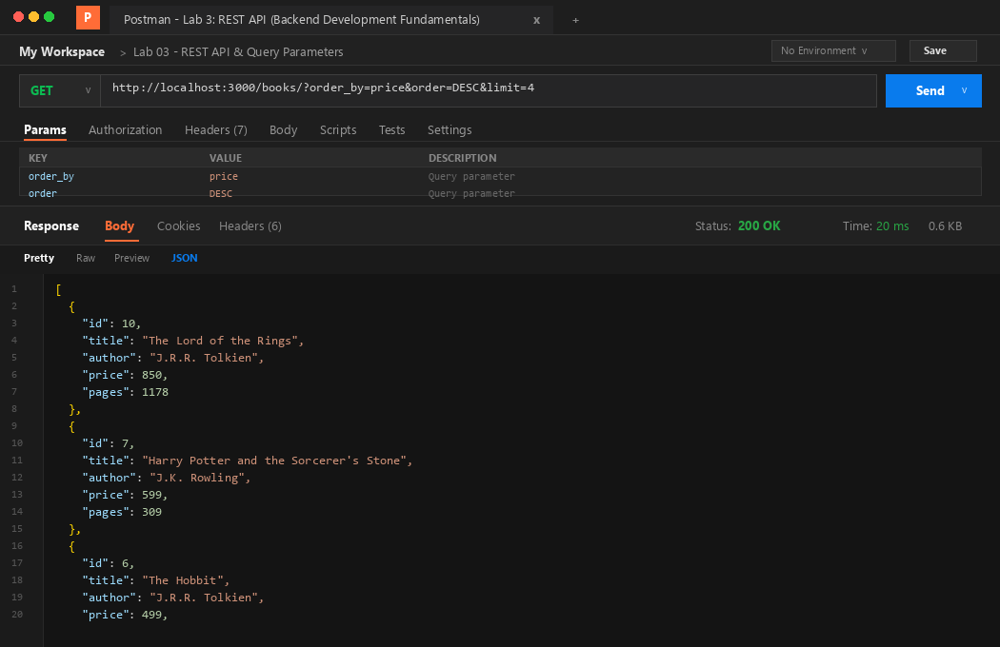

### 5. GET Single Book (`/books/1/`)
Fetches the record corresponding to primary key `id = 1` returning `200 OK`.
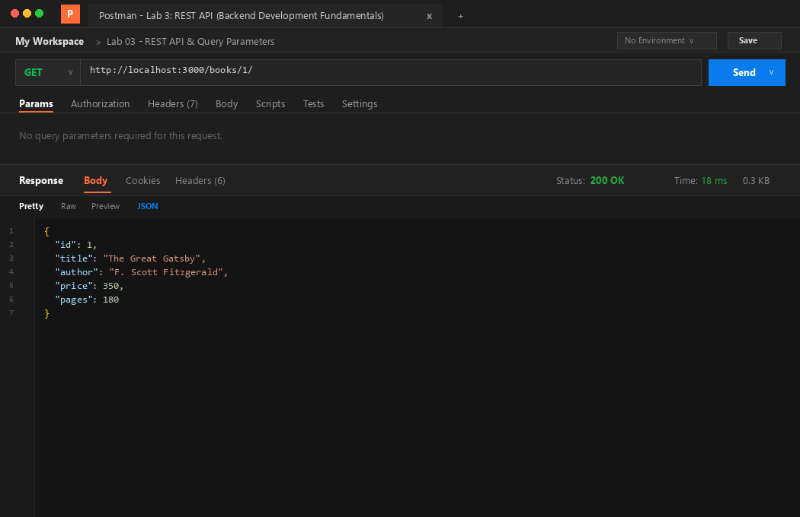

### 6. GET Single Book 404 Error Case (`/books/999/`)
Queries a non-existent ID (`999`) and returns `404 Not Found` with `{ "message": "Book Not Found" }`.


### 7. POST Add Book Success (`201 Created`)
Inserts a new book into the database with a validated payload. Returns HTTP status `201 Created` with the newly assigned `bookId`.
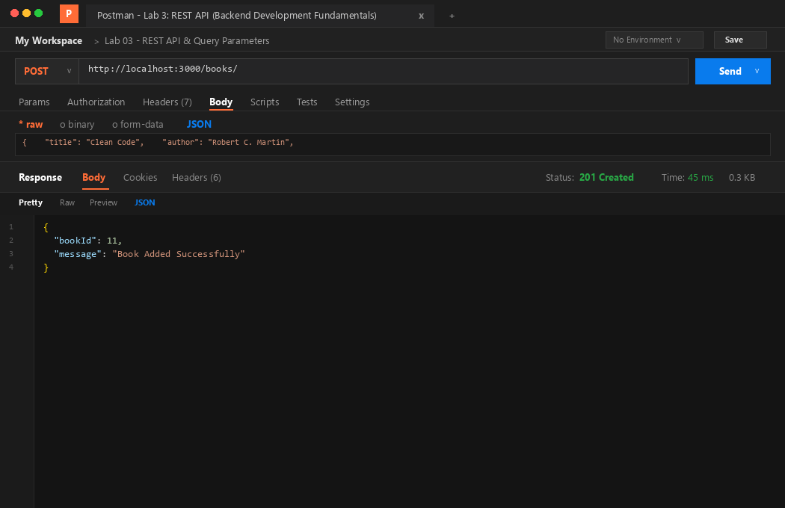

### 8. POST Missing Title Error (`400 Bad Request`)
Validates request body. When the `title` field is omitted or empty, the server rejects the request with `400 Bad Request`.
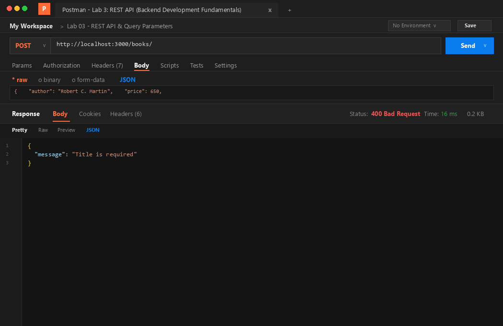

### 9. POST Non-Numeric Price Error (`400 Bad Request`)
Rejects requests containing invalid or non-numeric price values with `400 Bad Request`.


### 10. PUT Update Success (`200 OK`)
Updates the book record for `id = 1` with a validated request payload and returns `200 OK`.
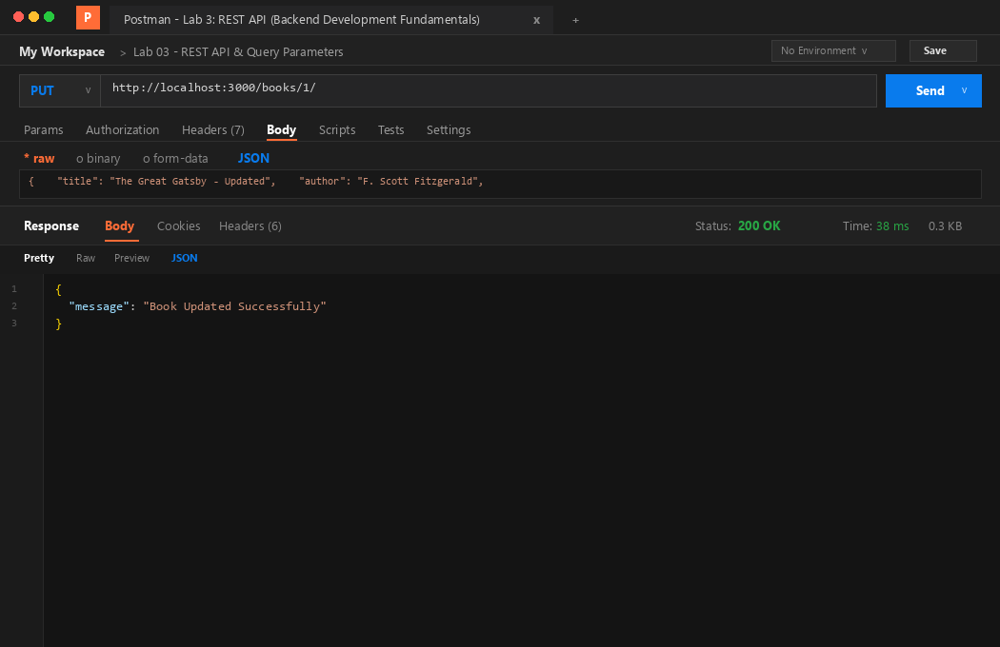

### 11. PUT Not Found (`404 Not Found`)
Attempts to update a non-existent book ID (`999`), returning `404 Not Found` with `{ "message": "Book Not Found" }`.
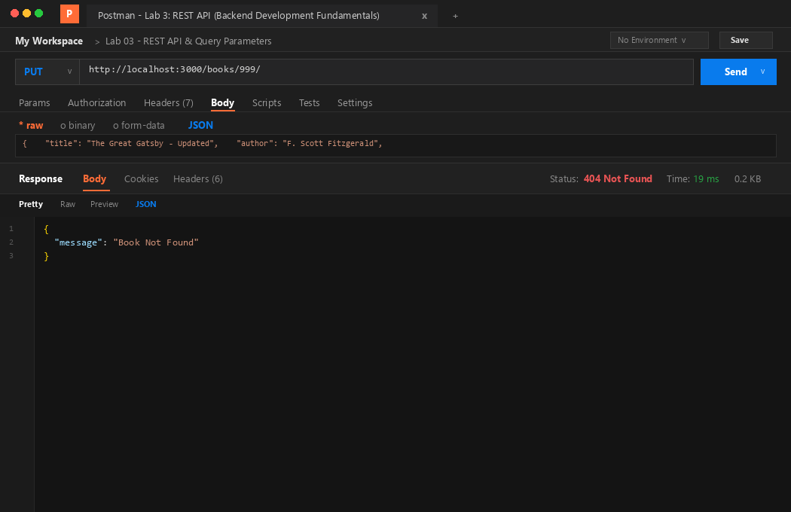

### 12. DELETE Success (`200 OK`)
Removes the book with `id = 2` from the database and returns `200 OK` with `{ "message": "Book Deleted Successfully" }`.
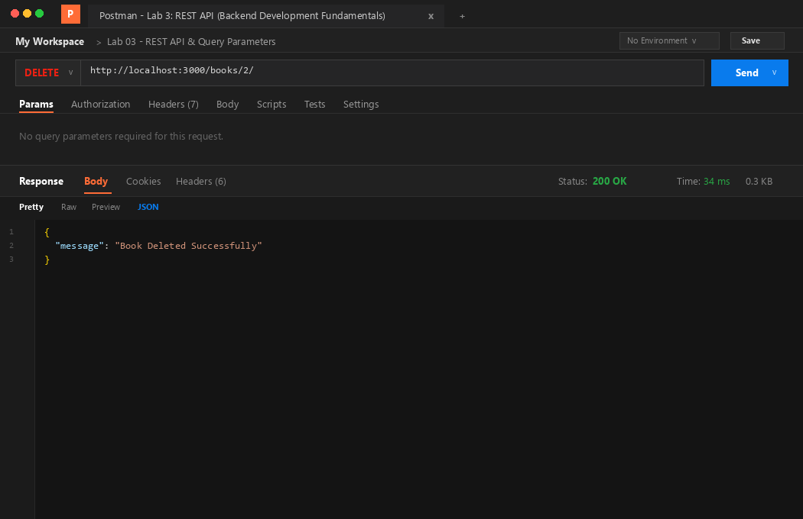

### 13. DELETE Not Found (`404 Not Found`)
Attempts to delete a non-existent ID (`999`), returning `404 Not Found` with `{ "message": "Book Not Found" }`.
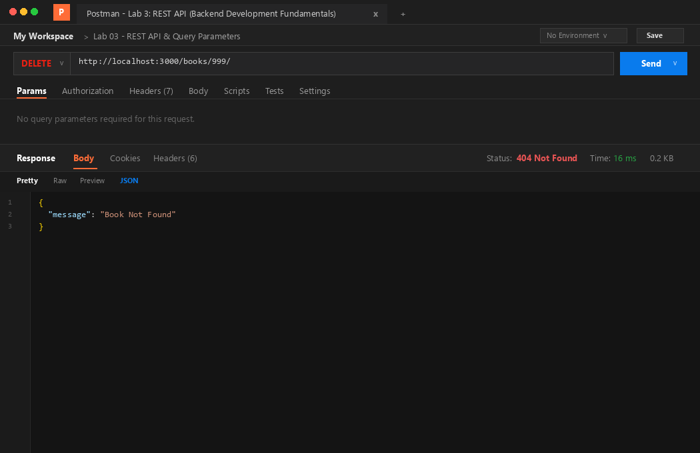

### 14. SQLite CLI Table View (Before & After Changes)
Terminal verification inspecting `books.db` using the SQLite CLI, demonstrating the table schema, initial 10 records, insertion of book 11, update of book 1, and deletion of book 2.
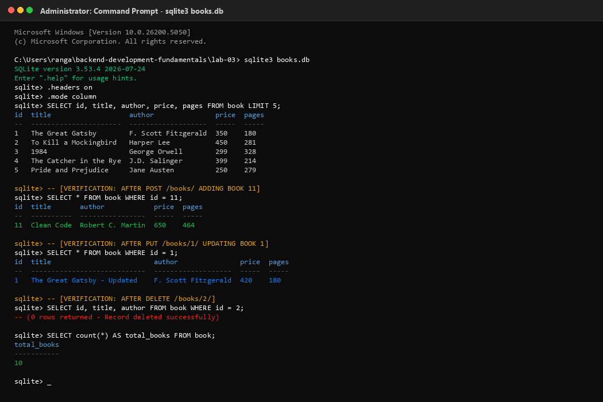

---

## Viva Questions and Answers

### 1. Query parameter vs path parameter?
- **Path Parameters**:
  - Embedded directly into the URL path hierarchy (e.g., `/books/:bookId/`).
  - Used to identify a **specific resource** or resource instance.
  - Essential to the identity and routing of the resource; omitting a path parameter points to a completely different endpoint or yields a 404 error.
  - Example: In `/books/5/`, `5` identifies the specific book whose ID is 5.
- **Query Parameters**:
  - Appended to the end of the URL following a question mark `?` as key-value pairs separated by ampersands `&` (e.g., `/books/?search_q=the&order_by=price&limit=5`).
  - Used to **filter, search, sort, or paginate** collections of resources.
  - Optional by nature; omitting query parameters allows the endpoint to fall back to sensible system defaults.
  - Example: In `/books/?min_price=300&max_price=600`, the query parameters filter which book records are included in the response.

### 2. What does stateless mean?
- **Statelessness** is a core architectural constraint of REST (Representational State Transfer).
- It dictates that **each request from a client to a server must contain all the information necessary to understand and complete the request**.
- The server does not store any client context or session state between requests. Every request is treated as completely independent and self-contained.
- **Benefits**:
  1. *Scalability*: Requests can be routed to any server instance in a cluster without session affinity or complex server-side session synchronization.
  2. *Reliability & Fault Tolerance*: If a server fails, incoming client requests can immediately be handled by another server without session recovery logic.
  3. *Simplicity & Visibility*: Monitoring and debugging tools can inspect an isolated request and understand its full context without needing to reconstruct preceding session states.

### 3. Which status code for bad input vs a missing record?
- **`400 Bad Request`**:
  - Returned when the client submits syntactically invalid data, missing mandatory fields, incorrect data types (such as passing a string where an integer is expected), or out-of-range values.
  - Indicates that the **input itself is flawed** and the server cannot process the request due to a client error.
  - Example: Omitting `title` in a `POST /books/` request or submitting `"price": "invalid"` triggers a `400 Bad Request` with `{ "message": "Title is required" }`.
- **`404 Not Found`**:
  - Returned when the request is syntactically well-formed, but the **targeted resource does not exist** on the server.
  - Indicates that the URL or specified identifier points to no current representation.
  - Example: Requesting `GET /books/999/` or `DELETE /books/999/` when no book with `id = 999` exists in the database triggers a `404 Not Found` with `{ "message": "Book Not Found" }`.

---

## Debugging Notes

During development and testing of Node.js and Express REST APIs with SQLite, several common backend bugs and runtime errors frequently occur. Below is a detailed breakdown of each error, its root cause, and the exact solution implemented.

### 1. Port Conflict (`EADDRINUSE`)
- **Symptoms**:
  ```
  Error: listen EADDRINUSE: address already in use :::3000
  ```
- **Root Cause**:
  Another running process (such as a previously started Node.js server, a background daemon, or another web server) is already bound and actively listening on port 3000. Operating systems prevent multiple sockets from binding simultaneously to the identical host port without special socket sharing flags.
- **Solution**:
  1. Identify the process ID (PID) occupying port 3000:
     - On Windows: `netstat -ano | findstr :3000`
     - On Linux/macOS: `lsof -i :3000`
  2. Terminate the blocking process:
     - On Windows: `taskkill /F /PID <PID>`
     - On Linux/macOS: `kill -9 <PID>`
  3. Alternatively, make the listening port configurable using environment variables in `app.js`:
     ```javascript
     const PORT = process.env.PORT || 3000;
     app.listen(PORT, () => { ... });
     ```

### 2. Wrong Import Path
- **Symptoms**:
  ```
  Error: Cannot find module '../sqlite3' or Error: Cannot find module './db'
  ```
- **Root Cause**:
  Attempting to require a package or module with an inaccurate relative path, missing filename extension, or importing a package before executing `npm install`. Node's CommonJS module resolution checks core modules first, then traverses `node_modules` up the directory tree, and resolves relative paths starting strictly from `__dirname`.
- **Solution**:
  1. Verify the exact package name installed in `package.json` (`dependencies`). For external packages, import without relative slashes:
     ```javascript
     const express = require('express');
     const sqlite3 = require('sqlite3');
     const { open } = require('sqlite');
     ```
  2. For local file paths, always anchor relative file paths using `path.join(__dirname, ...)` to guarantee reliable cross-platform resolution independent of the current working directory:
     ```javascript
     const dbPath = path.join(__dirname, 'books.db');
     ```

### 3. Table-Name Typo (`no such table`)
- **Symptoms**:
  ```
  SQLITE_ERROR: no such table: books
  ```
- **Root Cause**:
  Mismatch between the table identifier defined in the SQLite DDL schema (`CREATE TABLE book (...)`) and the identifier referenced in SQL queries (`SELECT * FROM books`). SQLite table names are singular or plural depending strictly on the schema definition.
- **Solution**:
  1. Inspect the exact table name in the schema creation script (`setupDb.js`):
     ```sql
     CREATE TABLE book (id INTEGER PRIMARY KEY AUTOINCREMENT, ...);
     ```
  2. Consistently align every SQL query throughout `app.js` to match the exact schema table name (`book`, singular):
     ```sql
     SELECT * FROM book WHERE title LIKE ? ...;
     INSERT INTO book (title, author, price, pages) VALUES (?, ?, ?, ?);
     UPDATE book SET title = ? ... WHERE id = ?;
     DELETE FROM book WHERE id = ?;
     ```

### 4. Missing `await` in Asynchronous Operations
- **Symptoms**:
  - Routes returning `[]` or unresolved `Promise { <pending> }` instead of database rows.
  - Express sending responses before queries finish executing.
  - Unhandled promise rejection warnings in the terminal console.
- **Root Cause**:
  Database drivers in modern Node.js (including `sqlite` and `node:sqlite`) return Promises for asynchronous I/O operations (`db.get()`, `db.all()`, `db.run()`, `db.exec()`). If a function omits the `await` keyword, JavaScript immediately continues synchronous execution with the pending Promise object rather than the resolved database dataset.
- **Solution**:
  1. Ensure the route callback or enclosing function is explicitly declared with the `async` keyword:
     ```javascript
     app.get('/books/:bookId/', async (req, res) => { ... });
     ```
  2. Prepend every asynchronous database invocation with `await` and wrap in structured `try...catch` blocks:
     ```javascript
     const book = await db.get(getBookQuery, [bookId]);
     if (book === undefined) {
       return res.status(404).send({ message: 'Book Not Found' });
     }
     res.status(200).send(book);
     ```
